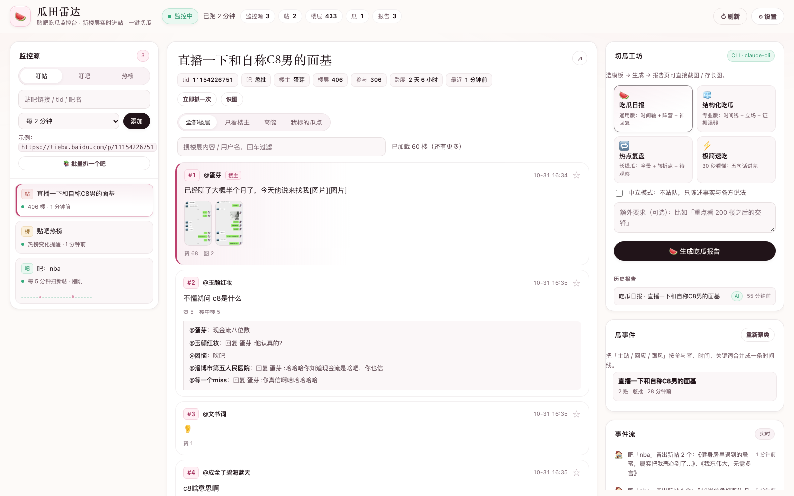
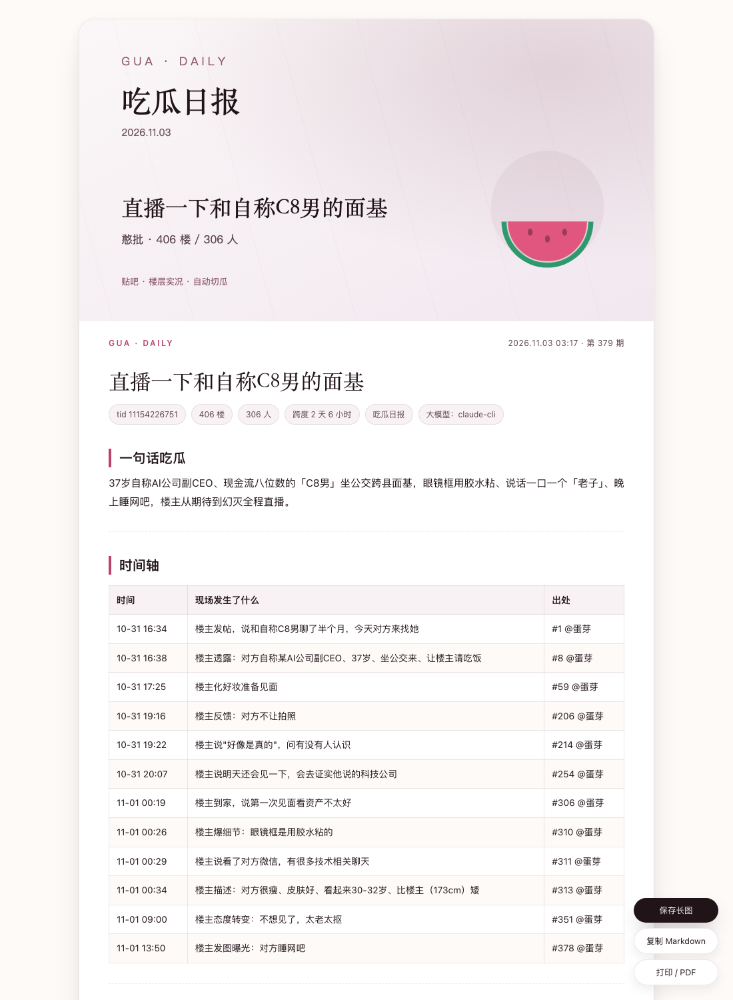
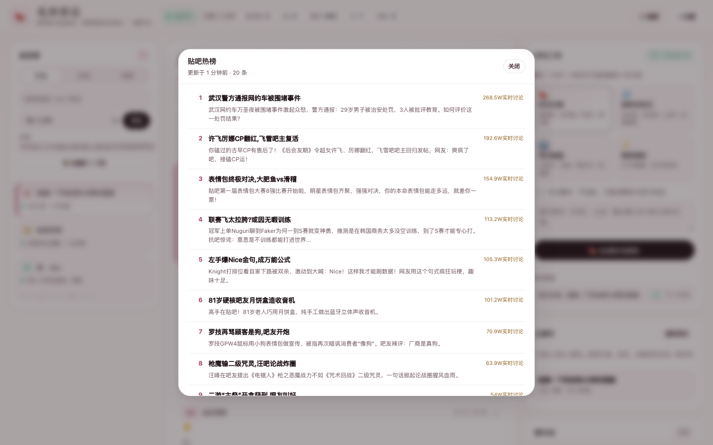
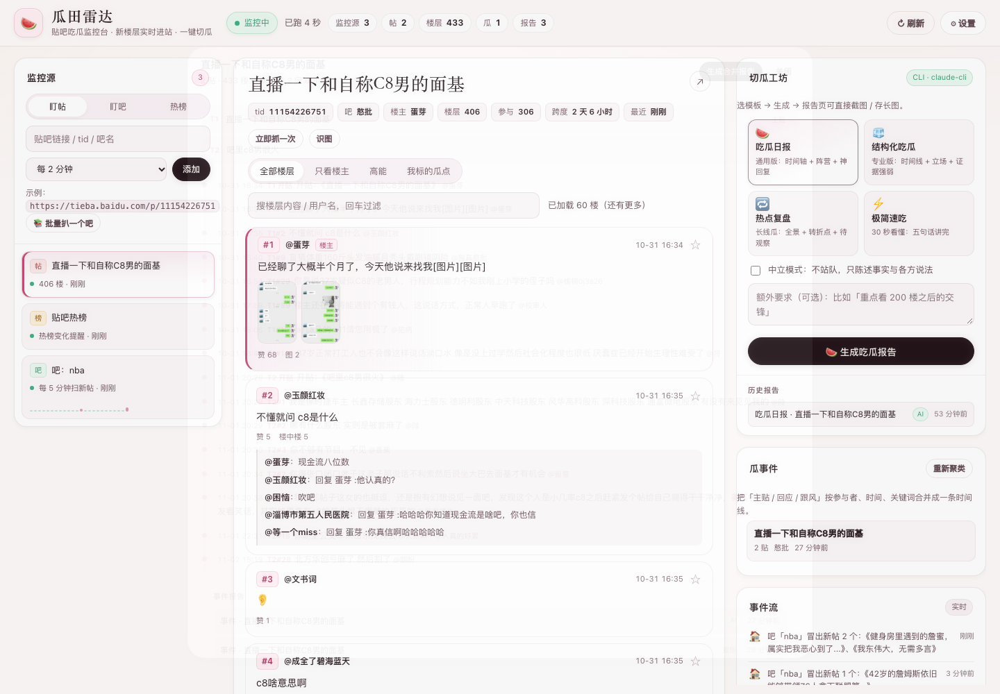
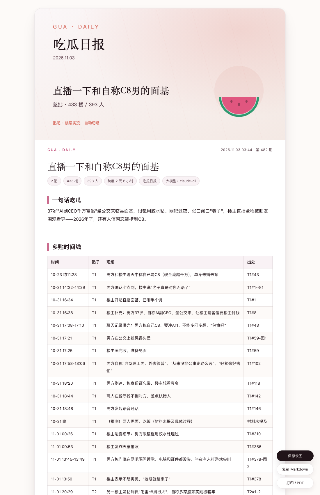
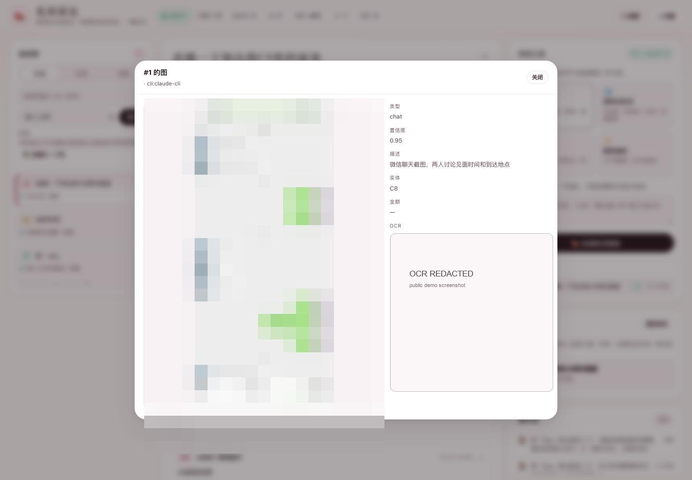

# 瓜田雷达 🍉

贴吧吃瓜监控台：**盯帖 → 抓楼层 → 看反转 → 一键切瓜**。

给一个帖子链接，它会自己按间隔巡检，把新楼层、楼中楼、删楼、关键词命中记成事件流；
**图片会下载并识别**，**多张贴子会按人物/时间/关键词合并成同一个事件**；
想总结时选一个模板，本地规则或大模型直接把几百楼揉成一份能发帖的《吃瓜日报》。

- 视觉：暖纸张底 + 墨色 + 莓红点缀，衬线标题 + 药丸控件 + 轻阴影，监控台与报告页同一套 token
- 核心纯 Python 标准库；缩略图用 Pillow（可选），本地 OCR 用 macOS Vision（可选）
- 贴吧 JSON 接口直连：`page_pc`（15/页）、`pb/page`（30/页）、`floor`（楼中楼全量）、
  `frs/page`（吧列表）、`mo/q/search/thread`（吧内搜索），签名已逆向，匿名链路可跑
- 四套提示词模板：吃瓜日报 / 结构化吃瓜 / 热点复盘 / 极简速吃
- **图片识别**：多模态 API（OpenAI 兼容 / Anthropic / 本机 `claude -p`）优先，
  没配就退回 macOS Vision OCR；聊天截图、转账图、长图都能读
- **多贴合并**：同一吧 + 参与者 + 时间 + 词 + 互链打分，自动聚成「主贴 / 回应 / 跟风」事件
- **按吧批量**：翻吧列表 + 吧内搜索，按回复数挑帖抓详情，再自动聚类
- 报告页可截图、可存长图、可复制 Markdown；封面可接生图 API，不接就用本地 SVG













---

## 30 秒跑通

```bash
cd "吃瓜雷达"

# 1. 起服务（--seed 会塞一个正在直播的演示帖 + 贴吧热榜）
python3 app.py --port 8765 --seed

# 2. 打开
open http://127.0.0.1:8765
```

首次全量抓一个 400 楼的帖子约 15–20 秒，抓完左侧会变成「405 楼 · 306 人」，
中间楼层流、右侧事件流、热度条都会亮起来。

```bash
# 不想自动轮询，只看网页：
python3 app.py --no-monitor

# 换端口 / 换库：
python3 app.py --port 9000 --db data/other.db
```

---

## 界面

三栏，从左到右是「监控源 → 楼层流 → 切瓜工坊」：

| 区域 | 干什么 |
| --- | --- |
| **监控源** | 加帖 / 加吧 / 加热榜；每个源有状态灯、新楼数、近 24 次抓取的热度条；悬停出现「抓 / 停 / 删」 |
| **楼层流** | 全部 / 只看楼主 / 高能 / 我标的瓜点；关键词高亮；★ 标记瓜点；楼中楼内联；**图片缩略图点开看 OCR**；「识图」一键跑图片理解 |
| **切瓜工坊** | 四个模板 + 中立模式 + 额外要求；生成过程有日志；历史报告一点就开 |
| **瓜事件** | 自动聚类出的多贴事件，点开看 T1/T2 时间线，一键「生成合并报告」 |
| **事件流** | 新楼层、楼主更新、关键词命中、删楼、标题变动、抓取失败、识图完成 |
| **批量扒吧** | 吧名 + 页数 + 关键词 + 最少回复，自动抓详情并聚类 |

报告页是新窗口级排版：封面 + 数据 chips + Markdown 正文，右下角三个按钮：
**保存长图**（前端 canvas 导出 PNG）、**复制 Markdown**、**打印 / PDF**。

---

## 监控是怎么工作的

### 盯帖

1. **首次全量**：`r=1` 倒序从第 1 页翻到 `total_page`，再用 `r=2` 第 1 页补回 **1 楼正文**
   （匿名只能看 `r=2` 的第一页，正好够用）。
2. **增量**：每次只打最新一页，发现新楼层就顺着往回翻，直到接上已知楼层
   （最多 6 页，防刷屏）。
3. **直播加速**：一轮发现新楼 → 接下来 5 分钟改成 15 秒一拉；静下来自动回到设定间隔。
4. **删楼对账**：每 6 小时做一次全量，服务端不再返回的楼层标记 `deleted`，事件流里能看到。
5. **失败退避**：连续失败按 2 的幂退避到 15 分钟，不会把贴吧打出 403。

### 盯吧 / 热榜

- **盯吧**：每轮拉 `frs/page` 前 30 个帖子，新帖进事件流；标题含关键词、回复数达标的自动转成「盯帖」源（最多同时转 3 个）。
- **热榜**：`hottopic` 榜单变化进事件流，适合发现新瓜。

### 事件类型

`new_floors` 新楼层 / `op` 楼主更新 / `keyword` 关键词命中 / `title` 改标题 /
`import` 首次入库 / `watch` 开始监控 / `forum` 吧里新帖 / `auto_watch` 自动转盯 /
`hot` 热榜上新 / `error` 抓取失败。

关键词默认是「反转、实锤、打脸、破防、删帖、道歉、证据、截图、律师函、报警、网暴…」，
设置页可以改成你自己的瓜点词。

---

## v2 接口层：主楼 / 楼中楼 / 搜索

| 用途 | 接口 | 关键点 |
| --- | --- | --- |
| 主楼 15/页 | `/c/f/pb/page_pc` | `r=1` 倒序可匿名翻到底；`r=2` 第 1 页带 `first_floor` |
| 主楼 30/页 | `/c/f/pb/page` | 实测 `r=1` 是**正序**，第 1 页含 1 楼，分页更省请求 |
| 楼中楼全量 | `/c/f/pb/floor` | `kz + pid + pn + rn`；返回 `subpost_list` / `subpost_num`，列表页只内嵌 4–5 条，必须单独补 |
| 吧列表 | `/c/f/frs/page` | `kw + pn + rn + sort_type` |
| 吧内搜索 | `/mo/q/search/thread` | `word + fname + pn`，20/页，匿名可用，`media` 直接带图 |
| 热榜 | `/hottopic/browse/topicList` | HTML 正则解析 |

完整性对账：`reply_num ≈ 主楼层 + 楼中楼`；主楼用 `total_page × 页大小` 交叉核对，
缺页用另一条分页接口回补，楼中楼按 `subpost_num` 对账。
匿名链路的边界：`r=2` 深分页、折叠楼、部分用户主页是服务端登录门槛，不是加密；
遇到就降级到 `pb/page` + `floor` 补齐，并在报告里标注缺口。

---

## 图片识别

1. `content[type=3]` 直接给 `origin_src / big_cdn_src / cdn_src`（带 `tbpicau` 时效 token），
   抓到立即下载，按 sha1 去重，原图 + 520px 缩略图各存一份。
2. 识图路由：
   - 配置了多模态 → OpenAI 兼容 `/chat/completions`、Anthropic `/v1/messages`，或本机 `claude -p`（把图片路径交给 CLI 读）
   - 没配置 → macOS Vision OCR（`tools/vision_ocr.swift` 首次自动 `swiftc` 编译）
   - 模型失败 → 自动退回本地 OCR，并在分析结果里记 `error`
3. 输出统一 JSON：`type / ocr_text / description / entities / amounts / timestamps / confidence`，
   报告里以 `T1#12-图2` 引用；OCR 与正文对不上时会单独提示人工复核。
4. 成本控制：只处理有信息量的图（跳过纯表情/无字图），按 sha1 缓存，单帖可设 `limit`。

---

## 多贴合并

```text
score = 0.30×参与者重合 + 0.25×时间邻近 + 0.20×共同词
      + 0.15×互链 + 0.10×文本相似
同吧 +0.05；同吧且共享特征词 +0.18；阈值 0.55，0.45–0.55 进「待确认」
```

- 事件模型：`stories` + `story_threads`，角色分「主贴 / 相关帖」
- 时间线以楼层为原子，跨贴排序；每贴插「开贴」节点
- UI「瓜事件」点开看 T1/T2 合并时间线；「生成合并报告」走多贴提示词
- 误合并可在 API/DB 里手动拆，后续再加 UI

---

## 按吧批量

```bash
# 抓 nba 吧前 2 页、标题含「伦纳德」、回复≥20 的帖，取前 3 个抓详情并聚类
curl -X POST http://127.0.0.1:8765/api/forum/crawl \
  -H 'Content-Type: application/json' \
  -d '{"kw":"nba","pages":2,"keyword":"伦纳德","min_replies":20,"limit":3}'
```

也可以在网页左栏点「📚 批量扒一个吧」。任务日志实时回传，抓完自动重聚类。

---

## 四种切瓜模板

| key | 名称 | 适合 | 输出 |
| --- | --- | --- | --- |
| `daily` | 吃瓜日报 | 通用 | 一句话吃瓜 + 时间轴表 + 争议焦点 + 神回复 + 阵营分布 + 证据强弱 + 锐评 |
| `structured` | 结构化吃瓜 | 想快速核对 | 【一句话总结】【时间线】【关键人物与立场】【核心争议点】【网友阵营分布】【证据强弱与待核实】【一句话锐评】 |
| `review` | 热点复盘 | 还在发酵的长线瓜 | 时间线全景 + 多维信息 + 事实核查 + 当前状态 / 待观察点 |
| `quick` | 极简速吃 | 30 秒看完 | 五条：概括 / 简版时间线 / 谁对谁 / 站队 / 反转 |

两种引擎：

- **本地规则**（默认，零配置）：按楼层长度、情绪词、点赞、楼中楼数打分，抽时间轴代表楼层、
  统计阵营词频、把「听说 / 据说 / 可能」标成待核实。它只做**结构归纳**，报告开头会写明。
- **大模型**：同一批材料 + 模板 + 硬性规则（必须有出处、单方说法要标注、不造谣、不人身攻击），
  输出更像人写的日报。模型挂了会自动退回本地报告，并在文末注明原因。

两种模式都支持「中立模式」：只陈述事实和各方说法，不下谁对谁错的判决。

---

## 接多模态 / 大模型（可选）

三种接法，任选其一：

### 1. 网页设置（推荐）

右上角「设置 → 切瓜模型」，选预设（openai / deepseek / moonshot / qwen / zhipu / siliconflow / anthropic / cli），
填 Key 保存。配置存在本地 `data/guatan.db`，API 只回显尾号。

### 2. 环境变量

| 变量 | 作用 |
| --- | --- |
| `DEEPSEEK_API_KEY` / `OPENAI_API_KEY` / `MOONSHOT_API_KEY` / `DASHSCOPE_API_KEY` / `ZHIPUAI_API_KEY` / `ANTHROPIC_API_KEY` | 任一存在就会被自动识别 |
| `OPENAI_BASE_URL` | 覆盖 OpenAI 兼容端点 |
| `GUA_MODEL` | 覆盖模型名 |

### 3. 本机 CLI

设置里把类型改成 `cli`，命令填 `claude -p`（或任何读 stdin、把结果打到 stdout 的命令）。
适合已经有订阅、不想再配 Key 的情况。

> 没配任何模型时，报告页会明确写「本地规则切瓜（未调用大模型）」，不会假装是 AI 写的。

### 识图配置（与文本模型分开）

设置页「多模态识图」单独一组配置，存在 `vision` key：

| 类型 | 说明 |
| --- | --- |
| `openai` | 任意 OpenAI 兼容 `/chat/completions`，图片走 `image_url` base64 |
| `anthropic` | `/v1/messages`，图片走 base64 image block |
| `cli` | 本机命令（默认 `claude -p`），把图片绝对路径交给它用 Read 读，再解析 JSON |

没配就自动走 macOS Vision OCR；模型失败也会退回本地 OCR，并在 `media.analysis.error` 留痕。
所以「图片必须识别」这条不会因为没 Key 而断掉，只是复杂截图/表格的语义会弱一些。

---

## 封面生图（可选）

设置页填 OpenAI 兼容的 `/images/generations` 端点（base、model、size、key），
生成报告时自动配一张 16:9 封面。接口失败或没配置就用本地 SVG 封面（渐变 + 西瓜 + 标题），
报告永远有图。

---

## 目录

```
吃瓜雷达/
├── app.py                 # HTTP 服务 + JSON API + 任务队列
├── gossip/
│   ├── tieba.py           # page_pc / frs / hottopic 客户端（签名、r=1/r=2、楼中楼）
│   ├── monitor.py         # 调度、增量、直播加速、退避、事件
│   ├── db.py              # SQLite：源 / 楼层 / 事件 / 报告 / 配置
│   ├── prompts.py         # 四套模板 + 材料裁剪与拼装
│   ├── llm.py             # OpenAI 兼容 / Anthropic / CLI 适配
│   ├── summarize.py       # 打分、时间线、阵营、证据 + 本地报告
│   ├── render.py          # Markdown → HTML、封面 SVG、报告页（含存长图）
│   ├── image.py           # 生图 API
│   └── util.py
├── static/                # 三栏前端（原生 JS，无构建）
├── deploy/                # systemd + 一键部署脚本
├── tests/                 # 44 个单测 + API 集成测试
└── data/                  # guatan.db / 日志 / 封面（自动生成）
```

---

## API 速查

| 方法 | 路径 | 作用 |
| --- | --- | --- |
| GET | `/api/state` | 源、帖、事件、模型状态、统计（前端每 5 秒轮询） |
| POST | `/api/sources` | `{kind: thread/forum/hot, key, interval, keyword?}` |
| POST | `/api/sources/<id>/poll` `/toggle` | 立即抓 / 暂停启用 |
| DELETE | `/api/sources/<id>` | 移除监控（楼层保留） |
| GET | `/api/threads/<tid>?mode=all/op/hot/starred&q=&limit=&offset=` | 楼层流 |
| POST | `/api/floors/<tid>/<floor>/star` | 标瓜点 |
| POST | `/api/summarize` | `{tid, mode, provider: auto/local, neutral}` → `job_id` |
| GET | `/api/jobs/<id>` | 任务进度与结果 |
| GET | `/api/reports/<id>/html` / `.md` | 报告页 / Markdown |
| GET | `/api/threads/<tid>/media` | 图片列表 + OCR 结果 |
| POST | `/api/threads/<tid>/vision` | `{limit, force}` 下载并识图 → `job_id` |
| GET/POST | `/api/stories`、`/api/stories/build` | 事件列表 / 重新聚类 |
| GET | `/api/stories/<id>` | 事件详情 + 多贴时间线 |
| POST | `/api/stories/<id>/summarize` | 多贴合并报告 |
| POST | `/api/forum/crawl` | 按吧批量抓取并聚类 |
| POST | `/api/config` | 模型、BDUSS、监控页数、关键词、生图 |
| POST | `/api/import` | 导入 `replies.jsonl`（可复用「贴吧抽奖」抓的旧数据） |

---

## 测试

```bash
python3 -m unittest discover -s tests -v
```

覆盖：签名算法、tid 解析、楼层增删改、楼中楼挂载、筛选、统计、四种报告的必备章节、
Markdown 渲染（含表格 / 转义）、报告页、多贴聚类与跨贴时间线、多贴报告、OCR JSON 解析、
监控源 CRUD、任务与报告接口、媒体接口、坏请求。

---

## 部署到 VPS

```bash
# 目标机需要：Linux + python3 + systemd（Debian/Ubuntu 最省事）
bash deploy/deploy.sh 38.49.208.8 root ~/.ssh/newserver 22

# 如果目标机是密码登录：
PASSWORD='你的密码' bash deploy/deploy.sh 38.49.208.8 root '' 22

# 起来之后
open http://38.49.208.8:8788
```

脚本会：打包（不带 data/docs/tests）→ scp → `/opt/guatan` → 装 `guatan.service` →
`systemctl enable --now` → 本机 `/api/health` 自检；有 ufw 会自动放行 8788。

**国外服务器能不能用？** 能。实测从美国节点（70.36.107.74）：
`/c/s/pc/sync` 返回 200、`page_pc` 返回 15 楼；只有 HTML 页面会 403。本项目只走 JSON 接口，
所以国外 VPS 不影响采集，只是 HTML 兜底不可用。

---

## 参考站点怎么用

- `eztb.org`：目录式「吧 / 帖 / 用户」结构，参考信息架构与搜索入口
- `tieba.live`：实时帖子流，参考「事件流 / 热帖」的呈现方式
- `tieba.in`：索引与标签，参考筛选维度

这三个站点只做**产品形态参考**，不作为数据源（接口随时会变，且拿不到楼中楼/图片原图）。
本项目的所有数据都来自贴吧自己的 JSON 接口。

---

## 注意

- 只读取公开页面数据；默认 2 分钟一轮，别把间隔调到 30 秒以下去压贴吧。
- 匿名链路覆盖：主楼（`page_pc` / `pb/page`）、楼中楼（`floor`）、吧列表、吧内搜索、图片。
  `r=2` 深分页、折叠楼、部分用户主页是**服务端登录门槛**，不是加密；遇到就用另一条分页接口 + 楼中楼接口补齐，
  极端帖子（几千楼、大量折叠）才需要 BDUSS。
- 报告是**文本结构归纳**，不是事实认定；贴吧会吞楼，缺失楼层可能永远补不回来。
- 别拿它做开盒、网暴、挂人。模板里的硬性规则已经禁止人身攻击和道德定性，你自己也别加。
- 抓不全 / 403 百度安全验证：设置里填 `BDUSS`（只存在本地），或换网络。

---

## 常见问题

**Q：没有 API Key 能用吗？**
能。默认本地规则引擎，四种模板都能出；只是文风没有大模型自然。

**Q：第一次为什么慢？**
首次全量要翻 20–30 页，每页间隔 0.35 秒；抓完就只打最新一页了。

**Q：为什么楼层号不连续？**
贴吧服务端本来就不返回被删 / 审核中 / 折叠的楼层，正序接口同样跳过。

**Q：能监控多个帖吗？**
可以，加多少个源都行，线程池 4 并发，各自按自己的间隔跑。

**Q：报告能直接发贴吗？**
报告页「保存长图」导出 PNG，或者「复制 Markdown」贴到支持 Markdown 的地方；
`winners.md` 那套公示风格是另一个项目「贴吧抽奖」干的事。
